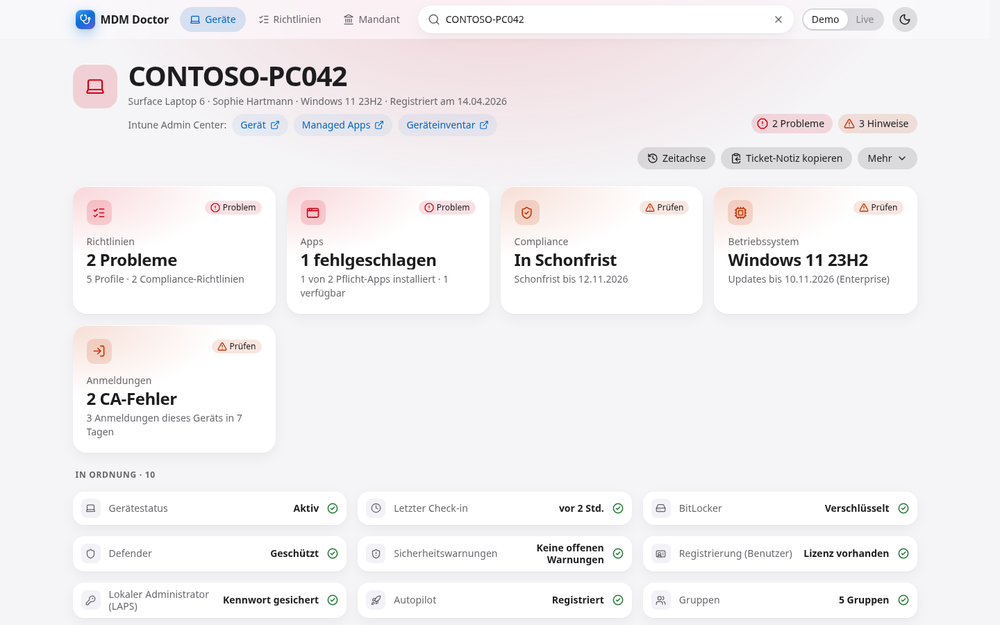
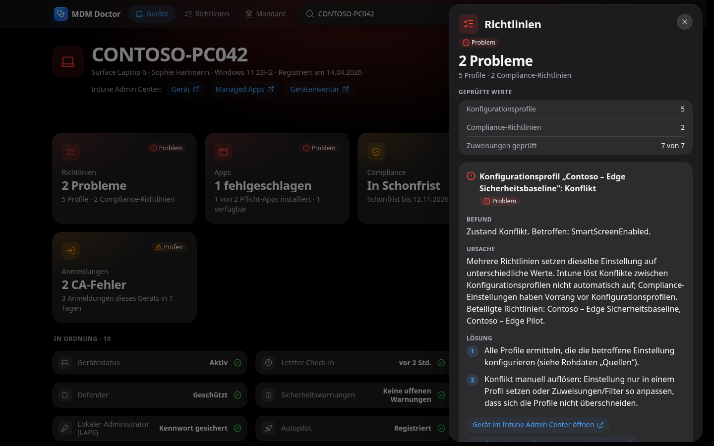
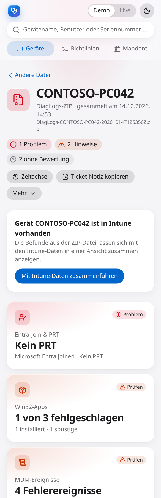

# MDM Doctor

**One-Click Intune Device Troubleshooter** – Gerätename eingeben und sofort Gerätestatus, Compliance, letzten Check-in, OS-Version, BitLocker, Defender, fehlgeschlagene Richtlinien und den App-Installationsstatus als klare Status-Kacheln sehen. Jede Kachel zeigt Befund, Ursache und Lösungsvorschläge. Zusätzlich lassen sich Intune-„Collect diagnostics“-ZIPs (`DiagLogs-*.zip`) direkt im Browser analysieren.

- **Read-only** – die App verändert keine Intune- oder Entra-Objekte.
- **Demo-Modus** mit realistischen, fiktiven Daten (Contoso) – keine Anmeldung nötig.
- **Live-Modus** über Microsoft Graph (MSAL, Authorization Code + PKCE), ausschließlich offiziell dokumentierte Endpunkte (`docs/graph-api-reference.md`).
- **ZIP-Analyse lokal** – Diagnose-Archive verlassen den Browser nie.

> Status: Hackathon-MVP (M1–M7 umgesetzt). Abnahmeprotokoll: [`docs/acceptance.md`](docs/acceptance.md).

| Dashboard (hell)                                                 | Detail-Sheet (dunkel)                                        | ZIP-Analyse (mobil)                                    |
| ---------------------------------------------------------------- | ------------------------------------------------------------ | ------------------------------------------------------ |
|  |  |  |

_Alle Screenshots zeigen ausschließlich fiktive Demo-Daten (Contoso)._

## Schnellstart

```bash
npm install
npm run dev
```

Öffnen: http://localhost:5173 (Demo-Modus).

## Demo-Skript (3 Minuten)

Für die Präsentation im Demo-Modus (keine Anmeldung, nur fiktive Contoso-Daten):

1. **Gesundes Gerät (30 s):** Chip `CONTOSO-PC001` → durchweg grüne Kacheln. Eine Kachel öffnen: „Alles in Ordnung“ mit geprüften Werten und Quelle (`GET …`). Zeigen: alles read-only, nur dokumentierte Graph-Endpunkte.
2. **BitLocker aus (30 s):** `CONTOSO-PC014` eintippen (⌘K/Strg+K) → Compliance und BitLocker rot. BitLocker-Kachel: Befund · Ursache · nummerierte Lösung · Rohdaten · Link zur Microsoft-Dokumentation.
3. **Richtlinienkonflikt (45 s):** `CONTOSO-PC042` → Richtlinien „2 Probleme“: Konflikt (beteiligte Profile) und Fehler `0x87D1FDE8` mit belegter Deutung; Compliance in Schonfrist; Windows 11 23H2 kurz vor Supportende; Apps „1 fehlgeschlagen“ (VPN-Client, Beta-Datenquelle ausgewiesen). Hinweis auf die offen ausgewiesene Settings-Catalog-Lücke. „Ticket-Notiz kopieren“ zeigen.
4. **Beispiel-ZIP (45 s):** Startseite › „Beispiel-ZIP analysieren“ → Entra-Join & PRT rot (Attempt Status `0xc000023c`, HTTP Error `0x80072ee7` mit Microsoft-Learn-Deutung), Win32-App `0x80070642` (= Win32 1602, Installation abgebrochen). „Mit Intune-Daten zusammenführen“ → zweiundzwanzig Kacheln in einer Ansicht; die Apps-Kachel zeigt denselben VPN-Client auch laut Intune als fehlgeschlagen. Betonen: Datei verlässt den Browser nie.
5. **Berechtigungsfall (30 s):** `CONTOSO-PC050` → Richtlinien und BitLocker zeigen „Fehlende Berechtigung“ inkl. Scope (`DeviceManagementConfiguration.Read.All`, `BitlockerKey.ReadBasic.All`); der Rest des Dashboards funktioniert.

6. **Richtlinie → Geräte (30 s):** Toolbar › „Richtlinien“ → alle Konfigurationsprofile und Compliance-Richtlinien, sortiert nach Problemen. „Contoso – VPN Always On“ (gestern geändert) öffnen → Gerätestatus „Nur Probleme“ zeigt `CONTOSO-PC042` mit Fehler; Klick auf den Namen öffnet das Gerät. Hinweis auf die offen ausgewiesenen Grenzen (Einstellungskatalog nur beta, kein Konflikt-Zähler in v1.0).

Weitere Szenarien: `CONTOSO-PC027` (Defender: Signaturen veraltet, Neustart, behandelte Bedrohung), `CONTOSO-PC033` (Check-in vor 41 Tagen), `CONTOSO-LT108` (Windows 10, Entra-Gerät deaktiviert), `CONTOSO-MAC07` (macOS, FileVault, Defender nicht anwendbar), `CONTOSO-IP015` (iPhone: MDM-Zertifikat läuft in 12 Tagen ab, nicht beaufsichtigt), `CONTOSO-AND21` (Android: Sicherheitspatch rund 200 Tage alt). Mehrdeutige Suche: `contoso-pc0`.

## Demo online

Die Demo (nur Mock-Daten, Live-Modus deaktiviert) läuft unter **https://darkatek7.github.io/intune-device-doctor/**. Sie wird bei jedem Push auf `main` per GitHub Actions (`.github/workflows/pages.yml`) gebaut und veröffentlicht. Einmalig in den Repo-Einstellungen _Settings › Pages › Source: **GitHub Actions**_ setzen.

Für einen **gehosteten Live-Modus** (eigener Build mit `VITE_APP_MODE=live`, `VITE_MSAL_CLIENT_ID`/`VITE_MSAL_TENANT_ID`) muss die Hosting-URL zusätzlich als SPA-Redirect-URI in der Entra-App-Registrierung eingetragen werden (bei Unterpfad-Hosting inkl. Pfad, z. B. `https://darkatek7.github.io/intune-device-doctor/`) und per `VITE_MSAL_REDIRECT_URI` exakt so gesetzt sein; Standard ist nur der Origin ohne Pfad. Der Produktions-Build setzt eine Content-Security-Policy (`vite.config.ts`), die Graph und `login.microsoftonline.com` erlaubt.

## Erscheinungsbild

Standard ist der dunkle Modus; der Schalter oben rechts (Sonne/Mond) wechselt zu Hell. Die Wahl bleibt im Browser gespeichert.

## DiagLogs-ZIP analysieren

Im Intune Admin Center › Geräte › _Gerät_ › „Diagnosedaten sammeln“ erzeugtes Archiv (`DiagLogs-<Gerät>-<Zeitstempel>.zip`) auf die Startseite ziehen oder über „Datei auswählen“ öffnen. Die Analyse läuft in einem Web Worker komplett im Browser: Es wird nur das Inhaltsverzeichnis gelesen und Texteinträge bei Bedarf entpackt; Binärdateien (`.evtx`, `.etl`, `.cab`) werden übersprungen. UPN, Tenant-ID und GUIDs werden in der Anzeige maskiert, die Push-ChannelURI wird verworfen. Gibt es im aktuellen Modus ein Gerät mit gleichem Namen, lassen sich ZIP- und Intune-Befunde zusammenführen. Fehlgeschlagene Win32-Apps erscheinen mit ihrem Namen (Live: `GET /deviceAppManagement/mobileApps/{id}`, Demo: fiktiver Contoso-Katalog) und einem Link „App im Intune Admin Center öffnen“; ohne Berechtigung oder für gelöschte Apps bleibt die App-ID sichtbar.

## Live-Modus einrichten

Der Live-Modus liest Gerätedaten **read-only** (nur HTTP GET) über Microsoft Graph. Anmeldung per MSAL (Authorization Code + PKCE, Redirect-Flow); Token-Cache in `sessionStorage`.

1. **App registrieren:** Entra Admin Center › App-Registrierungen › Neue Registrierung (einzelner Mandant).
2. **Plattform:** Authentifizierung › Plattform hinzufügen › **Single-page application** (nicht „Web“, sonst `AADSTS9002326`). **Redirect-URI** `http://localhost:5173` (bzw. die URL, unter der die App gehostet wird; muss exakt mit `VITE_MSAL_REDIRECT_URI` bzw. dem Origin übereinstimmen).
3. **API-Berechtigungen** (Microsoft Graph, **delegiert**) – genau diese, keine Schreibrechte:

   | Scope                                     | Zweck                                                                                           |
   | ----------------------------------------- | ----------------------------------------------------------------------------------------------- |
   | `User.Read`                               | Anmeldung/Profil                                                                                |
   | `DeviceManagementManagedDevices.Read.All` | Geräte, Defender, Compliance-Status                                                             |
   | `DeviceManagementConfiguration.Read.All`  | Konfigurationsprofil-Status, App-Namen (mobileApps); Ansicht „Richtlinien“ (Richtlinien, Zähler, Gerätestatus) |
   | `Device.Read.All`                         | Entra-Geräteobjekt                                                                              |
   | `BitlockerKey.ReadBasic.All`              | Nur ob ein BitLocker-Schlüssel hinterlegt ist (nie der Schlüssel selbst)                        |
   | `DeviceManagementServiceConfig.Read.All`  | Ablauf des Apple-MDM-Push-Zertifikats (nur Datum, keine Apple-ID), Autopilot-Eintrag des Geräts; VPP-Token der Ansicht „Mandant“ |
   | `AuditLog.Read.All`                       | Anmeldungen des Benutzers an diesem Gerät (Kachel „Anmeldungen“)                                |
   | `DeviceLocalCredential.ReadBasic.All`     | Windows LAPS: nur Zeitpunkte der Kennwortsicherung (nie das Kennwort)                           |
   | `LicenseAssignment.Read.All`              | Kachel „Registrierung (Benutzer)“: nur ob der primäre Benutzer einen Intune-Lizenzplan hat (optional) |
   | `SecurityAlert.Read.All`                  | Kachel „Sicherheitswarnungen“: offene Defender-for-Endpoint-Warnungen dieses Geräts (optional) |

   Anschließend **Admin-Consent** für den Mandanten erteilen (alle Intune-Scopes und `BitlockerKey.ReadBasic.All` erfordern ihn). **Nach einem Update der App, das einen neuen Scope ergänzt** (zuletzt `DeviceManagementServiceConfig.Read.All` für die Autopilot-Kachel), muss der Admin-Consent erneut erteilt werden – bis dahin zeigt die betroffene Prüfung „Fehlende Berechtigung“ mit dem Scope, der Rest funktioniert weiter.

4. **Konfiguration:** `.env.example` nach `.env.local` kopieren und setzen:

   ```bash
   VITE_APP_MODE=live
   VITE_MSAL_CLIENT_ID=<Anwendungs-(Client-)ID>
   VITE_MSAL_TENANT_ID=<Verzeichnis-(Mandanten-)ID>
   # optional, Standard ist der aktuelle Origin
   VITE_MSAL_REDIRECT_URI=http://localhost:5173
   ```

   Ohne Client- und Tenant-ID bleibt der Live-Modus deaktiviert; der Demo-Modus funktioniert unverändert. Dev-Server nach Änderungen an `.env.local` neu starten.

5. **Rollen der Nutzer:** Delegierter Zugriff = Schnittmenge aus Consent-Scopes und den Rechten des angemeldeten Nutzers. Ausreichend sind z. B. Intune-RBAC „Read Only Operator“ oder Entra „Global Reader“, „Helpdesk Administrator“, „Security Reader“, „Intune Administrator“. BitLocker-Metadaten sehen zusätzlich nur z. B. Cloud Device Administrator, Helpdesk Administrator, Intune Service Administrator, Security Reader, Global Reader. Fehlt etwas, zeigt die jeweilige Kachel „Fehlende Berechtigung“ mit dem benötigten Scope; der Rest des Dashboards funktioniert weiter.

   **Anmeldungen (`AuditLog.Read.All`, optional):** Der Scope wird beim Login nicht angefragt; ohne Admin-Consent zeigt nur die Kachel „Anmeldungen“ „Fehlende Berechtigung“. Das Anmeldeprotokoll erfordert laut Microsoft Entra ID P1/P2 und eine Entra-Rolle wie Reports Reader, Global Reader, Security Reader, Security Operator oder Security Administrator. Die angewandten Conditional-Access-Richtlinien (`appliedConditionalAccessPolicies`) lässt Graph ohne Leserecht auf Conditional-Access-Daten einfach weg (kein Fehler) – sichtbar sind sie z. B. für Global Reader, Security Reader, Security Administrator und Conditional Access Administrator; sonst zeigt die Kachel „Richtliniendetails nicht sichtbar (Rolle)“.

   **Windows LAPS (`DeviceLocalCredential.ReadBasic.All`, optional):** Der Scope wird beim Login nicht angefragt; ohne Admin-Consent zeigt nur die Kachel „Lokaler Administrator (LAPS)“ „Fehlende Berechtigung“. Laut Microsoft braucht das angemeldete Konto eine der Rollen Cloud Device Administrator, Helpdesk Administrator, Intune Service Administrator, Security Administrator, Security Reader oder Global Reader. Die App liest ausschließlich Gerätename und die Zeitpunkte der letzten Sicherung bzw. nächsten Aktualisierung – **nie das Kennwort** (`$select=credentials` wird nicht verwendet; dafür wäre `DeviceLocalCredential.Read.All` nötig, den die App nicht anfragt).

Hinweise: Bei Drosselung (HTTP 429/503) wartet der Client gemäß `Retry-After` (sonst Backoff 1 s, 2 s) und versucht es insgesamt bis zu dreimal. Die Teilstring-Suche nutzt `contains(deviceName, …)`; lehnt Graph den Filter mit HTTP 400 ab, wird clientseitig über die paginierte Geräteliste (max. 5 Seiten) gefiltert. Konfigurationsprofile aus dem Settings Catalog sind über die dokumentierten APIs nicht vollständig abrufbar. Die verwendeten Endpunkte stehen in `docs/graph-api-reference.md`.

## Befehle

| Befehl               | Zweck                                                      |
| -------------------- | ---------------------------------------------------------- |
| `npm run dev`        | Entwicklungsserver                                         |
| `npm run check`      | Lint, Typecheck, Tests, Build (Definition of Done)         |
| `npm run fixture`    | Synthetisches DiagLogs-Test-ZIP erzeugen                   |
| `npm run test:e2e`   | Playwright-E2E inkl. axe-Scan und Screenshots (4 Projekte) |
| `npm run check:full` | `check` + E2E                                              |

## Datenschutz

- Echte Diagnose-ZIPs enthalten personen- und tenantbezogene Daten. Sie werden ausschließlich lokal im Browser verarbeitet (kein Upload, kein `fetch` im Analysepfad) und dürfen nicht ins Repository (`.gitignore` sperrt `*.zip`, `*.cab`, `*.evtx`, `*.etl`).
- Die „Ticket-Notiz“ wird nur in die lokale Zwischenablage kopiert.
- Der Live-Modus liest nur (HTTP GET); BitLocker-Schlüsselwerte werden nie abgefragt (kein `$select=key`), es geht nur um die Frage, ob ein Schlüssel hinterlegt ist.
- Demo- und Testdaten sind fiktiv (Contoso, `contoso.com`).

## Bekannte Grenzen

- **Settings Catalog:** Gerätebezogene Zustände von Settings-Catalog-Profilen liefert die dokumentierte Graph-v1.0-API nicht; die Richtlinien-Kachel weist das offen aus (Status im Intune Admin Center prüfen). Undokumentierte Beta-Reports werden bewusst nicht genutzt.
- **Einstellungsdetails im Live-Modus:** Ob `deviceCompliancePolicyStates`/`deviceConfigurationStates` die `settingStates` ohne `$expand` liefern, ist nicht dokumentiert; ohne sie zeigt die App Befunde auf Richtlinienebene.
- **App-Status (Beta):** Die Kachel „Apps“ nutzt als einzige Ausnahme den dokumentierten Beta-Endpunkt `GET /beta/users/{userId}/mobileAppIntentAndStates` (kein v1.0-Pendant, gleicher Scope `DeviceManagementManagedDevices.Read.All`, kein zusätzlicher Consent). Er liefert den Status pro primärem Benutzer, ohne Fehlercode; In einem echten Tenant lieferte der Endpunkt eine leere Liste; die Kachel erscheint deshalb **nur, wenn Graph tatsächlich App-Status für das Gerät liefert** (sonst fehlt sie, statt dauerhaft „nicht verfügbar“ zu zeigen). Beta-APIs können sich ändern.
- **Anmeldungen:** Es wird nur die erste Seite (neueste 200 Einträge) des Anmeldeprotokolls des primären Benutzers der letzten 7 Tage gelesen und clientseitig auf die Entra-Geräte-ID eingegrenzt (ein Filter auf `deviceDetail/deviceId` ist nicht dokumentiert). Das Protokoll enthält laut Microsoft nur interaktive und erfolgreiche föderierte Anmeldungen; die Geräte-ID ist nur für in Entra registrierte Geräte gefüllt. IP-Adresse, Standort und Risikoangaben werden nie ausgewertet oder gespeichert.
- **Windows LAPS:** Nur Windows, nur Metadaten (Sicherungs- und Rotationszeitpunkt). Ob Graph für ein Gerät keinen Eintrag liefert (HTTP 404), weil LAPS nicht aktiv ist oder aus anderem Grund, ist in der Doku nicht beschrieben – die Kachel sagt das ehrlich. Der geforderte `User-Agent`-Header wird vom Browser selbst gesetzt (siehe „Live zu verifizieren“ in `docs/graph-api-reference.md`). Der Richtwert „Sicherung älter als 30 Tage“ ist ein eigener Wert dieser App, keine Microsoft-Vorgabe.
- **Windows Autopilot:** Nur Windows. `DeviceManagementServiceConfig.Read.All` ist optional (nicht beim Login angefragt); ohne Consent zeigt die Kachel „Fehlende Berechtigung“. Für die Autopilot-Liste ist laut Doku kein Filter verfügbar – die App liest höchstens 5 Seiten und sagt ehrlich „nicht gefunden (Seitengrenze)“, statt „nicht registriert“ zu behaupten. Das Bereitstellungsprofil ist über die dokumentierte v1.0-API nicht lesbar und wird so ausgewiesen.
- **Gruppen:** Zeigt die Entra-Gruppen **des Geräts** (direkt und verschachtelt, `Device.Read.All`). Gruppen des Benutzers sind nicht enthalten – dafür wäre `User.Read.All` nötig. Ohne Leserecht auf einen Objekttyp liefert Graph nur IDs; solche Gruppen werden als „ausgeblendet“ gezählt.
- **Weitere Geräte des Benutzers:** Kompakte Zeile im Geräte-Header (höchstens 5, Plattform-Symbol, Compliance-Punkt); Klick öffnet das Gerät wie ein Suchtreffer. Nur die erste Seite der Abfrage; bei Fehler oder fehlender Berechtigung entfällt die Zeile ohne Fehlermeldung.
- **Integritätsnachweis:** Nur Windows, nutzt den bereits angefragten Scope `DeviceManagementManagedDevices.Read.All`. Die Kachel zeigt die Rohwerte von `deviceHealthAttestationState` (Secure Boot, BitLocker-Status, Code Integrity, ELAM, TPM-Version …) unverändert – Microsoft dokumentiert für diese Felder keine möglichen Werte, deshalb werden sie nicht bewertet. Nur ein gesetztes `healthStatusMismatchInfo` („DHA-Dienst erkennt ein Integritätsproblem“) erzeugt eine Warnung.
- **Zuweisungen (Richtlinien- und Apps-Kachel):** Hinweis-Tabelle „Warum gilt diese Richtlinie / diese App?“, abgeglichen mit den Gerätegruppen (kein weiterer Scope, `DeviceManagementConfiguration.Read.All`). Höchstens 30 Abrufe je Gerät (4 parallel), auffällige Objekte zuerst; weitere werden als „nicht abgefragt“ ausgewiesen. Benutzergruppen werden nicht gelesen („vermutlich Benutzergruppe“). Dass die `id` eines Richtlinien-Gerätezustands die Richtlinien-ID ist, ist in der Dokumentation nicht belegt – nur GUIDs werden abgefragt, bei 404 steht „nicht auswertbar“. Zuweisungsfilter und Settings-Catalog-Zuweisungen gibt es nur in der Beta-API und sind „über dokumentierte API nicht verfügbar“.
- **Registrierung (Benutzer):** Nur für Geräte mit primärem Benutzer. Lizenz: `LicenseAssignment.Read.All` (optional, nicht beim Login; Rollen laut Microsoft z. B. Directory Readers, License Administrator, User Administrator) – die App liest nur die Intune-Serviceplans (`INTUNE_A`, `INTUNE_A_VL`, `INTUNE_EDU`; `INTUNE_O365` = „Mobile Device Management for Office 365“ ist ein eigener Hinweis, nur wenn kein anderer Intune-Plan da ist), nie weitere Lizenzdaten. Als fehlend gilt die Lizenz nur ohne Intune-Plan oder wenn alle Intune-Pläne deaktiviert sind; den Bereitstellungsstatus (`PendingInput` u. a.) meldet Graph für Intune-Pläne auch bei aktiver Lizenz, er wird nur angezeigt. Gerätelimit: `DeviceManagementServiceConfig.Read.All` (optional, wie bei Autopilot). Benutzergruppen werden nicht gelesen, deshalb ist das für den Benutzer wirksame Limit nicht sicher bestimmbar – die Kachel zeigt alle Limit-Konfigurationen und weist darauf hin, wenn die Geräteanzahl (erste Seite der Geräte des Benutzers) das kleinste Limit erreicht. Das Intune-Limit gilt laut Microsoft nicht für Co-Management, Gruppenrichtlinien-Registrierung, Entra-Join, Autopilot und Geräteregistrierungs-Manager.
- **Sicherheitswarnungen:** Offene Warnungen von Microsoft Defender for Endpoint zum Gerät. Scope `SecurityAlert.Read.All` (optional, nicht beim Login; Rollen laut Microsoft z. B. Security Reader, Global Reader, Security Operator, Security Administrator). Für die Liste ist kein Filter auf das Gerät dokumentiert: Die App liest die neuesten Warnungen (höchstens 3 Seiten à 100, nur Defender for Endpoint), ordnet sie über die Geräte-Evidenz (Entra-Geräte-ID, sonst Gerätename) zu und blendet behobene aus – bei mehr Warnungen steht „nur die neuesten N Warnungen geprüft“. Personenbezogene Felder der Antwort (angemeldete Benutzer, IP-Adressen, Bearbeiter) werden nie übernommen. Bearbeiten kann man Warnungen nur im Defender-Portal (Link im Befund).
- **Verbindungstest (nur Live):** Schaltfläche „Verbindungstest“ in der Geräteansicht (auch `?device=<id>&view=connection-test`). Ruft jeden von der App verwendeten Graph-Endpunkt für das gewählte Gerät genau einmal lesend auf (nacheinander, abbrechbar, startet nur auf Klick) und zeigt je Endpunkt Version (der freigegebene Beta-Endpunkt ist gekennzeichnet), Scope, Ergebnis, Dauer, Anzahl der Einträge und die **Namen** der Felder – nie Werte, IDs oder Namen. Der Bericht ist als Markdown kopierbar und dient der Live-Verifikation (`docs/live-verification.md`). Im Demo-Modus gibt es ihn nicht. Er braucht keine zusätzlichen Berechtigungen; Endpunkte, deren optionaler Scope fehlt, erscheinen als „Verweigert (403)“.
- **Mandanten-Status (Ansicht „Mandant“):** Schaltfläche „Mandant“ in der Toolbar (auch `?view=tenant`), in Demo und Live. Zeigt Apple-MDM-Push-Zertifikat und Apple-VPP-Token (Ablauf, Zustand, letzte Synchronisierung) mit denselben Kacheln wie die Geräteansicht; Scope `DeviceManagementServiceConfig.Read.All` (optional, ohne ihn nur diese Kachel „Fehlende Berechtigung“). Die VPP-Antwort enthält das Token selbst und die Apple-ID – beides wird nie gelesen. ADE/DEP-Token, Android Enterprise, Autopilot-Synchronisierung und NDES-Connectors sind nur in der Beta-API dokumentiert und werden als „nicht abrufbar“ ausgewiesen. Die 30-Tage-Warnschwelle für VPP-Token ist ein eigener Richtwert.
- **Richtlinien → Geräte (Ansicht „Richtlinien“):** Schaltfläche „Richtlinien“ in der Toolbar (auch `?view=policies`, eine geöffnete Richtlinie als `&policy=<configuration|compliance>:<id>`), in Demo und Live, ohne zusätzlichen Scope (`DeviceManagementConfiguration.Read.All`). Beantwortet „Bei welchen Geräten schlägt Richtlinie X fehl?“: Liste aller Konfigurationsprofile und Compliance-Richtlinien (Typ, Plattform aus dem Profiltyp, Zähler Fehler/fehlgeschlagen/ausstehend/erfolgreich), sortiert nach Problemen, mit Namensfilter; Klick zeigt den Gerätestatus (Gerät, Benutzer, Modell, Status, zuletzt gemeldet; Standard „Nur Probleme“ = Fehler, Konflikt, nicht konform). Grenzen: Zähler werden für höchstens 50 Richtlinien abgefragt (zuletzt geänderte zuerst, 4 parallel) – der Rest steht als „nicht abgefragt“ da; Listen höchstens 5 Seiten, Gerätestatus höchstens 3 Seiten. Einen Zähler für Konflikte oder „nicht konform“ gibt es in v1.0 nicht (nur im Gerätestatus). Der Gerätestatus enthält keine dokumentierte Geräte-ID und keine Plattform – Gerätenamen öffnen das Gerät über die normale Suche, die Tabelle zeigt das Modell. Microsoft kündigt den Gerätestatus von Konfigurationsprofilen ab Mai 2026 ab (Hinweis in der Ansicht). Einstellungskatalog und Endpunktsicherheit sind nur in beta dokumentiert und fehlen (ausgewiesen).
- **Suche:** `$filter` auf `deviceName` ist nur in der Beta-Ressource dokumentiert; bei HTTP 400 fällt die App auf die paginierte Liste (max. 5 Seiten) zurück. Gegen einen echten Tenant noch nicht verifiziert.
- **Fehlercodes von App-Installationen** liefert der Beta-Endpunkt nicht; Win32-App-Fehlercodes gibt es aus dem DiagLogs-ZIP.
- **Windows-Edition** (Home/Pro vs. Enterprise) meldet Graph v1.0 nicht; Supportenden werden für Enterprise/Education bewertet, Home/Pro als Hinweis.
- **Binärlogs** (`.evtx`, `.etl`, `.cab`) und OEM-Codepage-Ausgaben (ipconfig, certutil) werden im MVP nicht ausgewertet. dsregcmd läuft bei der Diagnosesammlung nicht im Benutzerkontext; SSO-/Benutzerstatus kann abweichen (wird im Befund erwähnt).
- **macOS/iOS/Android:** Kein hinterlegter Supportstatus für das Betriebssystem (Kachel „ohne Bewertung“).

## Dokumentation

- `docs/PLAN.md` – Gesamtplan
- `docs/graph-api-reference.md` – verifizierte Graph-Endpunkte, Felder, Scopes
- `docs/live-verification.md` – Prüfliste für den Live-Modus gegen einen echten Tenant
- `docs/diaglogs-format.md` – Aufbau der DiagLogs-ZIPs
- `docs/ui-guidelines.md` – Designregeln
- `CLAUDE.md` – Arbeitsregeln für Claude Code
